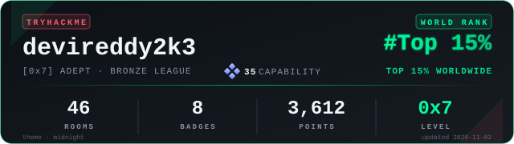

<h1 align="center">Hi 👋, I'm Praveen Devireddy</h1>
<h3 align="center">Computer Science Student | Cybersecurity Enthusiast</h3>

  

---

### 👨‍💻 About Me

- 🎓 Integrated MSc Computer Science Student (2022–2027)
- 🔐 Currently learning Cybersecurity
- 🐧 Practicing Linux and Networking
- 🛡️ Interested in SOC Analysis and Ethical Hacking
- 🐍 Comfortable with Python
- 🚀 Believe in learning by building and experimenting

### 🛠️ Languages and Tools

  

### 🔐 Cybersecurity Tools

  
  
  
  

### 📜 Certifications & Learning

  
  
  

- 🛡️ [**Foundations of Cybersecurity**](https://www.coursera.org/account/accomplishments/verify/IFI0PD3K3QDZ) — Google (Coursera)
- 🔐 [**Pre Security**](https://tryhackme.com/certificate/THM-HUMZWC5BSY) — TryHackMe
- 🌐 [**Introduction to Cybersecurity**](https://www.credly.com/earner/earned/badge/df3c5cc2-0de1-4179-9da1-cc5f9754c6a1) — Cisco Networking Academy

### 📄 Resume

  

### 🏴‍☠️ TryHackMe Profile

  

---

### 📫 Connect With Me

  

---

  <b>“Consistency beats intensity. Keep learning, keep building.”</b>

